<a href="https://xainner.com">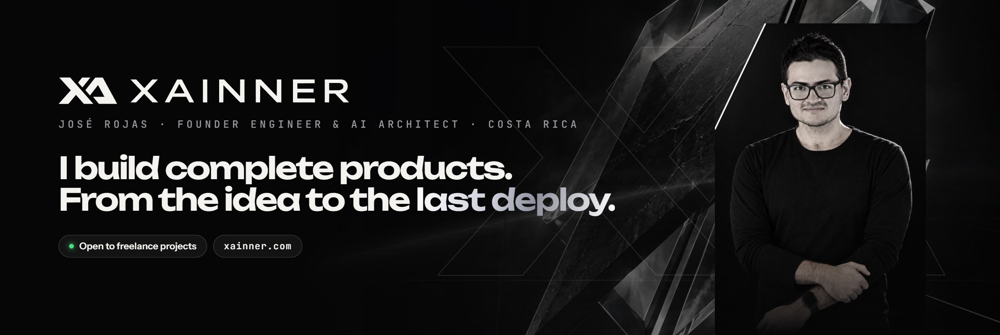</a>

  
  
  
  

I'm **José Rojas**, a software engineer from Costa Rica who likes owning the whole thing: the product idea, the interface, the API, the database, the deploy script and the film that launches it. Most of what's below I built alone, end to end.

🇨🇷 Ingeniero de software en Costa Rica. Construyo productos completos, de la idea al último deploy. Disponible para proyectos freelance: <a href="https://xainner.com/es/">xainner.com/es</a>.

  <a href="https://xainner.com/#reel">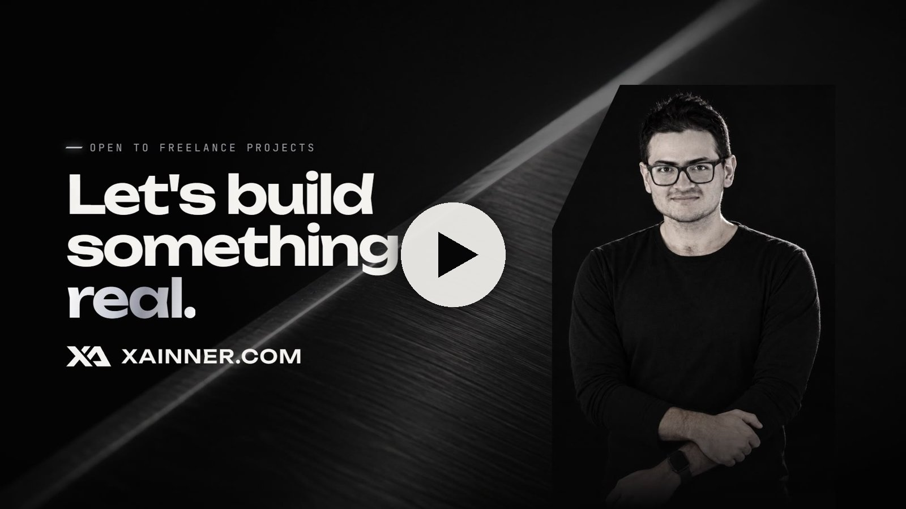</a>
   ▶ The showreel: real products, real captures — on <a href="https://xainner.com/#reel">xainner.com</a>

## ✦ Flagship: Rinari

An AI engineer that **proves its work**: it reads the repo, reproduces the bug, fixes it and shows the evidence. One engine, three ways in.

<table>
<tr>
<td width="50%" valign="top">
<a href="https://github.com/Xainner/Rinari-Agent">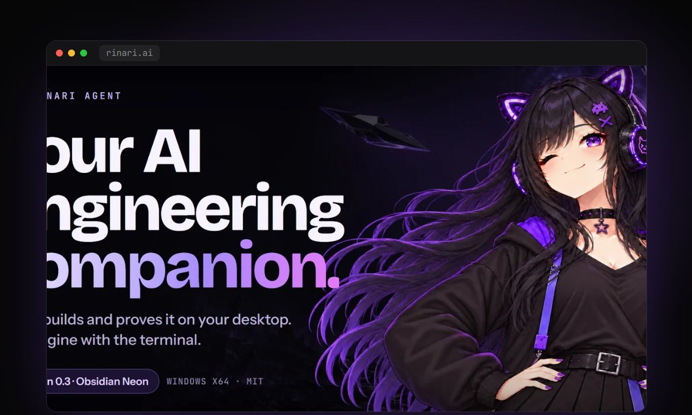</a>
<h3><a href="https://github.com/Xainner/Rinari-Agent">Rinari Agent</a></h3>
Desktop app for Windows. Plan, Build and Review modes, approval gates, parallel subagents and an evidence panel for every claim. 
<code>Electron</code> <code>React</code> <code>TypeScript</code> <code>Zustand</code>
</td>
<td width="50%" valign="top">
<a href="https://github.com/Xainner/Rinari-CLI">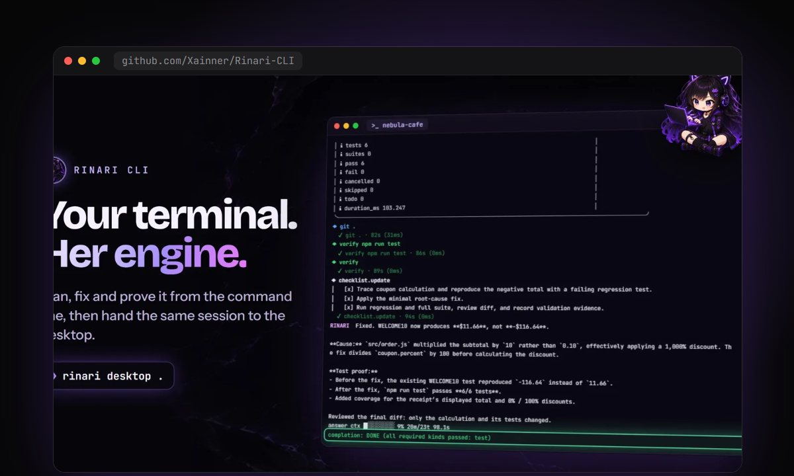</a>
<h3><a href="https://github.com/Xainner/Rinari-CLI">Rinari CLI</a></h3>
The engine and its terminal client: ask, plan, fix and prove it from the command line, then hand the same session to the desktop. 
<code>Python</code> <code>Typer</code> <code>Rich</code> <code>tree-sitter</code>
</td>
</tr>
<tr>
<td colspan="2" valign="top">
<a href="https://rinari.bot">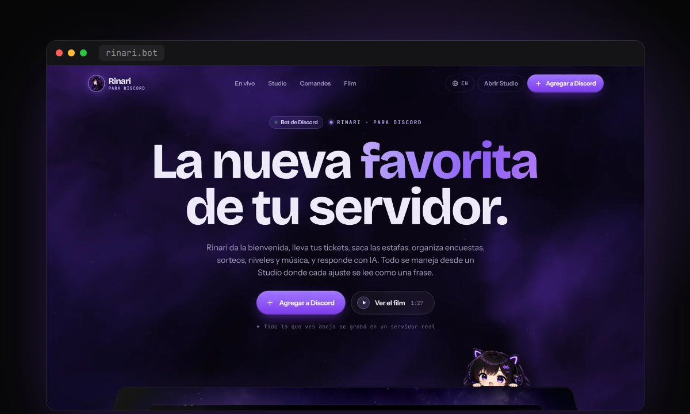</a>
<h3><a href="https://rinari.bot">Rinari for Discord</a></h3>
Moderation, tickets, levels, music and configurable AI, run from a web dashboard with Discord sign-in. 
<code>discord.js</code> <code>Fastify</code> <code>Next.js</code> <code>BullMQ</code> <code>PostgreSQL</code> <code>Redis</code>
  → <a href="https://rinari.ai">rinari.ai</a>
</td>
</tr>
</table>

## ✦ New: Media Lab

<table>
<tr>
<td width="50%" valign="top">
<a href="https://github.com/Xainner/media-lab">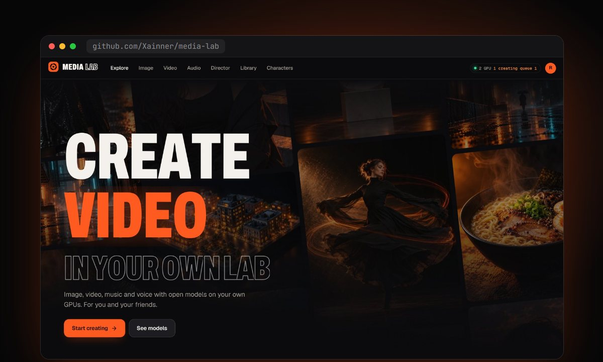</a>
</td>
<td width="50%" valign="top">
<h3><a href="https://github.com/Xainner/media-lab">Media Lab</a></h3>
A <b>self-hosted AI media studio</b>: images, video with synchronized audio, full songs, sound effects and voices from open models, all on my own GPUs. Nothing goes to a cloud generator.  
A <b>Director</b> turns a song into a music video, an agent plans whole requests, and an <b>MCP server with 55 tools</b> opens the studio to Claude and other clients. Private accounts with TOTP and per-account quotas. 
<code>Python</code> <code>FastAPI</code> <code>React</code> <code>Vite</code> <code>ComfyUI</code> <code>MCP</code> <code>Docker</code>
</td>
</tr>
</table>

## ✦ Worlds I've built

<table>
<tr>
<td width="50%" valign="top">
<a href="https://dondecr.com">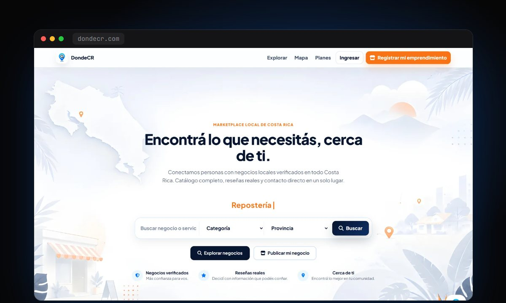</a>
<b><a href="https://dondecr.com">DondeCR</a></b> · Lead engineer 
Local business discovery for Costa Rica, with <b>self-hosted AI moderation</b> and a private quarantine for flagged uploads. 
<code>PHP 8.2</code> <code>CodeIgniter</code> <code>MySQL</code> <code>Leaflet</code> <code>TensorFlow.js</code> <code>Docker</code>
</td>
<td width="50%" valign="top">
<a href="https://teammaker.club">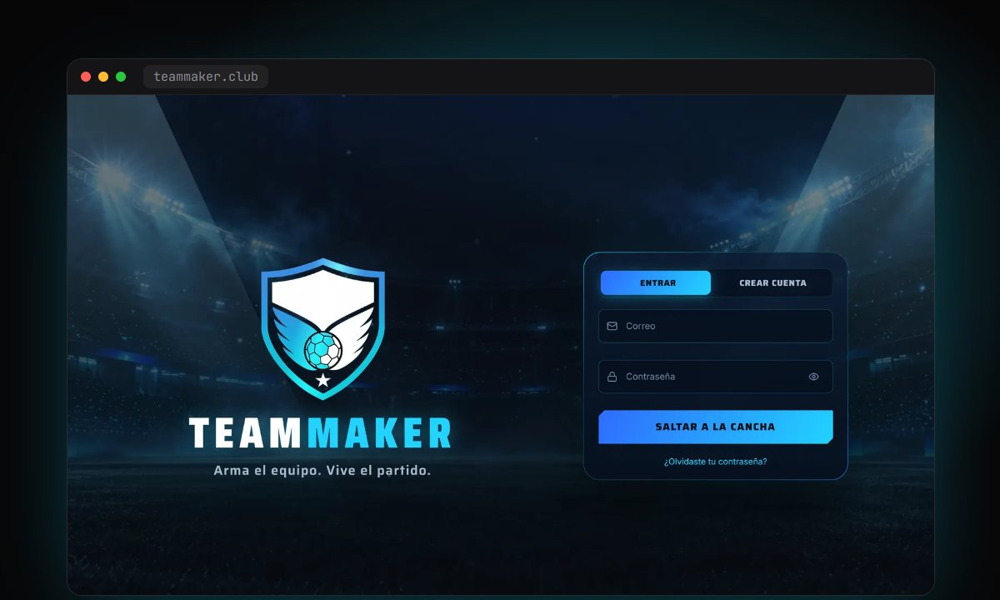</a>
<b><a href="https://teammaker.club">TeamMaker</a></b> · Solo, design to stores 
Pickup football played like a console game: ranked cards, live scoreboard, MVP votes. <b>Web, Android and iOS</b> from one codebase. 
<code>React</code> <code>TypeScript</code> <code>GSAP</code> <code>PHP 8</code> <code>MySQL</code> <code>Capacitor</code>
</td>
</tr>
<tr>
<td width="50%" valign="top">
<a href="https://legadotico.renxaii.com">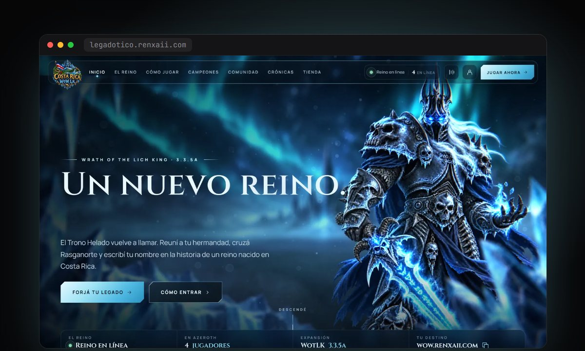</a>
<b><a href="https://legadotico.renxaii.com">Legado Tico</a></b> · Solo, full stack + C++ 
A WotLK fan server platform: a PayPal checkout delivered in-game by a <b>custom C++ AzerothCore module</b>, atomic and replay-tested. 
<code>PHP 8.3</code> <code>C++</code> <code>MySQL 8</code> <code>WebGL2</code> <code>Docker</code>
</td>
<td width="50%" valign="top">
<a href="https://recetica.com">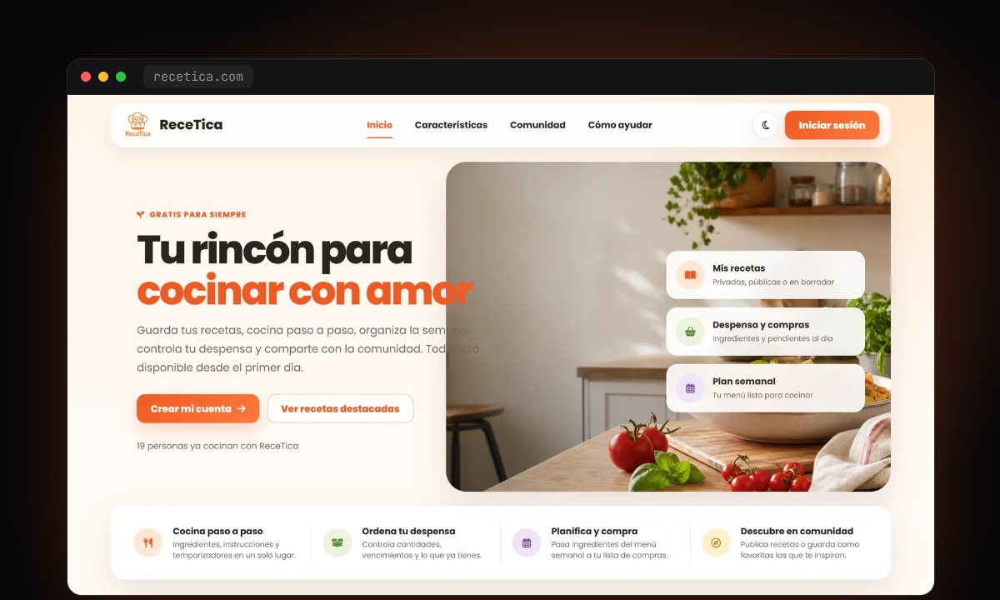</a>
<b><a href="https://recetica.com">Recetica</a></b> · Solo, product owner 
Recipes, a weekly planner, a pantry with expiry dates and a shopping list that converts units, with the <b>Rinari AI</b> assistant inside. 
<code>PHP</code> <code>CodeIgniter</code> <code>MySQL</code> <code>Capacitor</code>
</td>
</tr>
<tr>
<td width="50%" valign="top">
<a href="https://mimascotacr.com">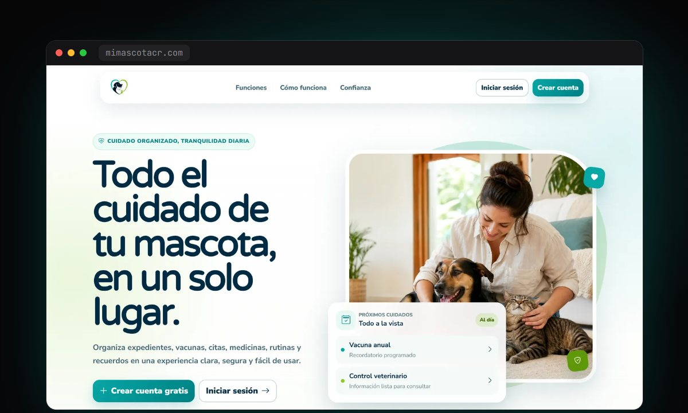</a>
<b><a href="https://mimascotacr.com">MiMascotaCR</a></b> · Solo, full stack 
Pet health as an installable PWA: records, vaccines, reminders and a <b>public emergency page</b> for every pet. 
<code>PHP 8</code> <code>CodeIgniter</code> <code>PWA</code> <code>FullCalendar</code> <code>OSM</code>
</td>
<td width="50%" valign="top">
<a href="https://paulo.hosting.renxaii.com">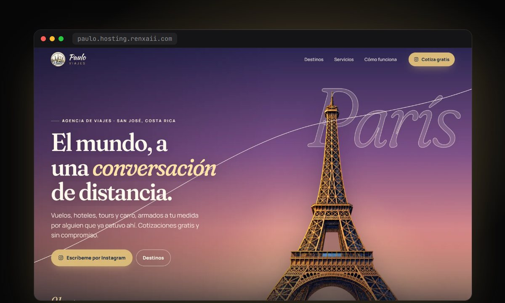</a>
<b><a href="https://paulo.hosting.renxaii.com">Paulo Viajes</a></b> · Client work 
A travel agency landing where a <b>d3 globe flies from SJO</b> to ten destinations as you scroll. 
<code>Astro</code> <code>GSAP</code> <code>DrawSVG</code> <code>d3-geo</code>
</td>
</tr>
<tr>
<td width="50%" valign="top">
<a href="https://renxaii.com">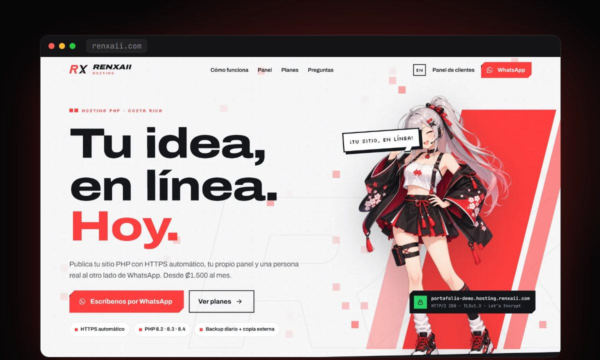</a>
<b><a href="https://renxaii.com">Renxaii Hosting</a></b> · Founder 
My own hosting business on servers I run myself, with a site whose <b>tests fail the build</b> if it over-promises. 
<code>HestiaCP</code> <code>Nginx Proxy Manager</code> <code>Python</code> <code>Astro</code>
</td>
<td width="50%" valign="top">
<a href="https://serdigitalcr.com">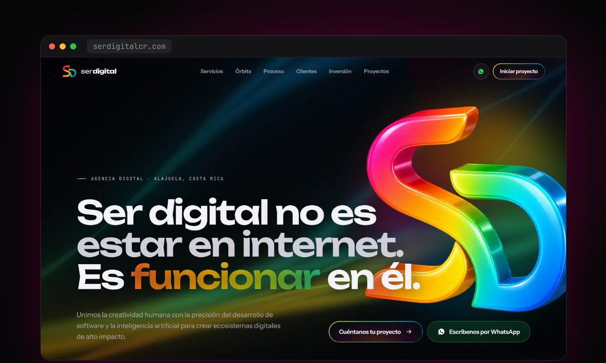</a>
<b><a href="https://serdigitalcr.com">SerDigital</a></b> · Lead Software Developer 
The software & AI agency where I lead development, including its <b>multi-tenant internal platform</b> (NestJS, PostgreSQL + pgvector). 
<code>Astro</code> <code>GSAP</code> <code>WebGL</code> <code>NestJS</code> <code>Prisma</code>
</td>
</tr>
</table>

Also: <a href="https://micanchacr.com">MiCanchaCR</a>, court booking for Costa Rica.

## ✦ Open source

<table>
<tr>
<td width="50%" valign="top">
<h3><a href="https://github.com/Xainner/toolbox">🧰 Toolbox</a></h3>
Self-hosted suite of <b>24 PDF and image tools</b>, iLovePDF + Photoroom style. Local AI (BiRefNet, Real-ESRGAN, OCRmyPDF), CPU by default with optional NVIDIA GPU. Adding a new tool is <b>a single file</b>: catalog, form, validation and page are generated from it. 
<code>FastAPI</code> <code>React 19</code> <code>Tailwind 4</code> <code>Docker</code>
</td>
<td width="50%" valign="top">
<h3><a href="https://github.com/Xainner/MCP-Servers">🧩 MCP-Servers</a></h3>
Hand-crafted <b>Model Context Protocol</b> servers for Planka, n8n and PufferPanel: full CRUD, typed schemas and predictable outputs for Claude, Cursor, VS Code and any MCP client. 
<code>TypeScript</code> <code>Node.js</code> <code>MCP</code>
</td>
</tr>
</table>

## ✦ Toolbox

Designed, built and shipped from San José, Costa Rica · <a href="https://xainner.com">xainner.com</a>

